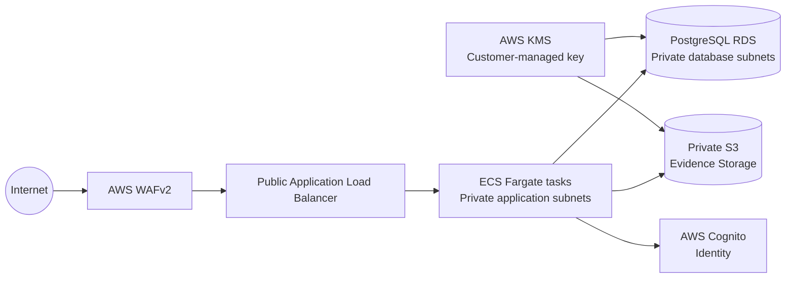

# Project Sentinel — AWS Infrastructure Reference

## Executive summary

Project Sentinel is a secure foundation for a document assessment and credentialing platform. The infrastructure is delivered in two phases:

1. **Phase 1 — Secure staging:** a cost-conscious environment for integration and acceptance testing. It uses smaller compute and database capacity and a single NAT gateway while retaining private application and database subnets, encryption, and a web application firewall.
2. **Phase 2 — Production:** a resilient deployment with larger capacity, Multi-AZ database availability, and a NAT gateway in each Availability Zone. Production sizing and scaling remain explicit environment inputs.

Both phases use the same composable Terraform modules so that security boundaries and deployment behavior stay consistent as capacity changes.

## Architecture



The Terraform provisions the network, WAF, KMS key, IAM roles, evidence bucket, load balancer, Fargate cluster/service, and PostgreSQL database. Cognito is shown as the intended managed identity boundary but is not provisioned by this reference implementation yet.

## Key architectural boundaries

- **Identity:** Authentication and MFA belong behind an identity provider boundary. The application is designed to integrate with Cognito rather than own credentials or authentication flows.
- **Evidence storage:** Documents are isolated in a private, versioned S3 bucket, encrypted with KMS, and accessed by a narrowly scoped workload role. This boundary can later be replaced by a dedicated document or evidence service without changing the assessment domain.
- **Assessment:** Assessment logic runs as a containerized service behind the ALB. Its API boundary separates the business workflow from storage and identity implementations.
- **Credentials:** Credential issuance and verification are separate domain capabilities from assessment. They can be moved to a dedicated managed credentialing service while preserving the application and evidence boundaries.

## Security first

- AWS WAFv2 protects the public ALB with AWS-managed common and known-bad-input rules plus a configurable rate limit.
- S3 evidence and RDS database storage are encrypted at rest with a customer-managed KMS key with automatic rotation enabled.
- The VPC separates public load-balancer subnets from private application and database subnets; compute and database ingress is security-group constrained.
- ECS task and execution roles have separate, scoped permissions. The application role is limited to the evidence bucket and its KMS key; the execution role is limited to image/log access, the configured database secret prefix, and KMS decryption.
- S3 public access is blocked at both the bucket and account-independent bucket settings; bucket versioning and TLS-only access are enforced.

## Repository layout

```text
.
├── README.md
├── docs/
│   ├── architecture_decisions.md
│   └── security_model.md
├── environments/
│   ├── staging/
│   │   ├── main.tf
│   │   ├── variables.tf
│   │   └── terraform.tfvars.example
│   └── production/
│       ├── main.tf
│       ├── variables.tf
│       └── terraform.tfvars.example
└── modules/
    ├── compute/
    ├── networking/
    ├── security/
    └── storage/
```

## Getting started

Use Terraform 1.10 or newer and AWS provider 5.x. Authenticate through your organization's approved AWS SSO or short-lived role-assumption workflow; do not put access keys in Terraform files or variable files.

Before initializing either environment, bootstrap a dedicated state bucket outside these environment stacks. Enable S3 versioning, default encryption with the specified KMS key, public-access blocking, and tightly scoped IAM access. Grant the Terraform role the S3 read/write/delete permissions needed for its state object and `.tflock` object, plus the required KMS permissions. The state bucket and key are security-critical and must not be managed by the same state they contain.

```powershell
Set-Location .\environments\staging
Copy-Item .\terraform.tfvars.example .\terraform.tfvars
Copy-Item .\backend.hcl.example .\backend.hcl
# Edit terraform.tfvars with account-specific values.
 # Edit backend.hcl with the bootstrapped state bucket, region, and KMS key.
terraform init -backend-config=backend.hcl
terraform validate
terraform plan
```

Repeat from `environments/production` for production, using its separate backend configuration and state key. Review and approve any state migration prompt before proceeding. Commit each root's generated `.terraform.lock.hcl` file to pin exact provider selections. Never commit `terraform.tfvars`, populated backend configuration, state files, or saved plans.

The example variables are illustrative only. Review CIDRs, image URI, secret naming, database sizing, alarms, backup retention, and organizational policies before deployment. The application container must listen on the configured container port and implement its own health endpoint.

## Scope and production readiness

This is an infrastructure reference, not a complete application or compliance certification. Cognito, CI/CD, centralized logging/alerting, database migrations, domain/TLS certificate provisioning, backup recovery testing, and organizational guardrails require account-specific integration. The ALB listener is HTTP in this baseline; production must add an ACM certificate and HTTPS listener before accepting sensitive user traffic.
